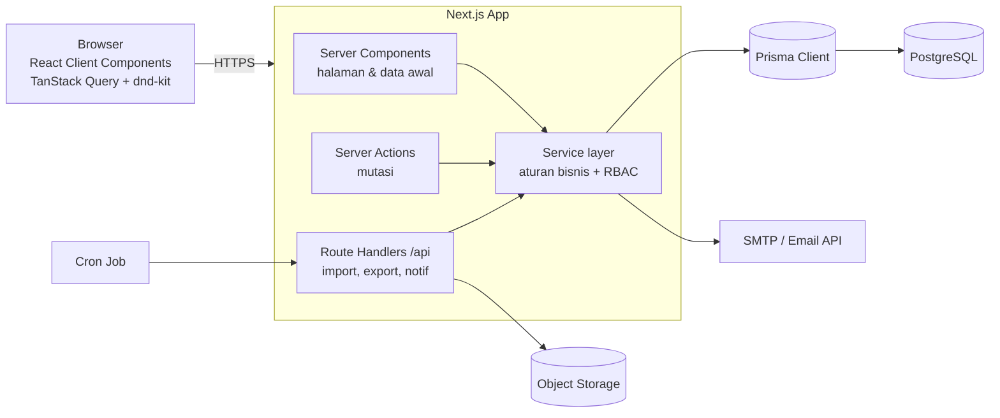
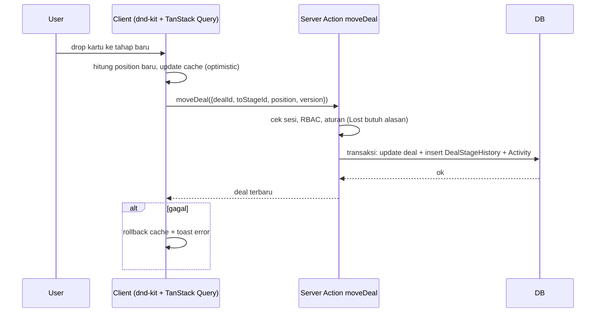
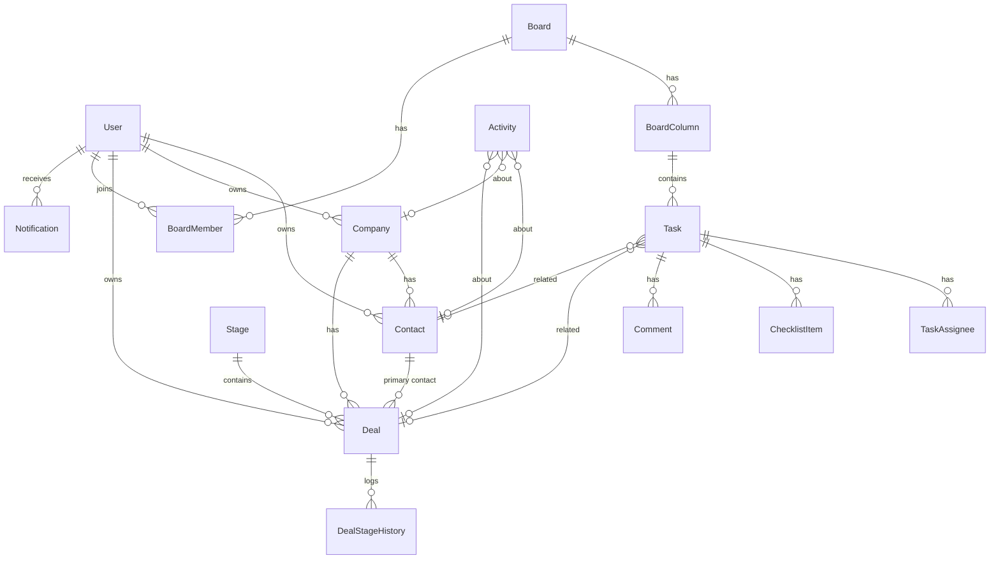

# Technical Requirements Document (TRD)
**Produk:** CRM + Kanban Internal
**Versi:** 1.1 · **Tanggal:** 31 Oktober 2026 · **Referensi:** [PRD.md](PRD.md), [FRD.md](FRD.md), [DESIGN.md](DESIGN.md)
**Revisi 1.1:** kelola pengguna (bagian 5.3), hak akses per pengguna (bagian 5.4, TR-SEC-12), verifikasi sesi ke database (TR-SEC-11), hashing bcrypt sesuai implementasi.

---

## 1. Ringkasan Teknis
Aplikasi web monolit berbasis **Next.js (App Router, TypeScript)** dengan **Prisma ORM** dan **PostgreSQL**. Rendering server-first (React Server Components) untuk halaman data, Client Components untuk interaksi Kanban. Mutasi data melalui **Server Actions** (dipanggil dari UI) dan **Route Handlers** (`/api/*`) untuk kebutuhan seperti import file, export, dan polling notifikasi.

## 2. Tech Stack
| Lapisan | Teknologi | Alasan |
|---------|-----------|--------|
| Framework | Next.js 15+ (App Router), React 19, TypeScript (strict) | Full-stack dalam satu repo, SSR, Server Actions |
| Database | PostgreSQL 16 | Relasional, andal, full-text search (`pg_trgm`) |
| ORM | Prisma | Type-safe, migrasi terkelola |
| Autentikasi | Auth.js (NextAuth v5) — Credentials provider (email & password saja), sesi JWT | Standar ekosistem Next.js |
| Hash password | argon2 (atau bcrypt cost 12) | Keamanan |
| Validasi | Zod (dipakai bersama di client & server) | Satu skema untuk form & API |
| Form | React Hook Form + `@hookform/resolvers/zod` | Performa & DX |
| UI | Tailwind CSS v4 + shadcn/ui (Radix) + lucide-react | Konsisten dengan [DESIGN.md](DESIGN.md), aksesibel |
| Drag & drop | `@dnd-kit/core` + `@dnd-kit/sortable` | Ringan, mendukung keyboard & touch |
| Data fetching client | TanStack Query | Cache, optimistic update, polling |
| Tabel | TanStack Table | Sort, seleksi, kolom dinamis |
| Grafik | Recharts | Dashboard |
| Tanggal | date-fns (+ locale `id`) | Ringan |
| CSV | Papa Parse | Import/export |
| Email | Nodemailer (SMTP) atau Resend | Undangan, reset password, digest |
| Penyimpanan file | S3-compatible (MinIO / Cloudflare R2) | Lampiran tugas, logo |
| Job terjadwal | Cron (Vercel Cron atau `node-cron` di container) | Notifikasi jatuh tempo, tandai deal macet |
| Testing | Vitest, Testing Library, Playwright | Unit, komponen, E2E |
| Kualitas kode | ESLint, Prettier, Husky + lint-staged | Konsistensi |
| Monitoring | Sentry, log terstruktur (pino) | Error tracking |

## 3. Arsitektur



### 3.1 Prinsip Lapisan
1. **UI (app/, components/)** — tidak pernah memanggil Prisma langsung.
2. **Actions / Route Handlers** — tipis: autentikasi sesi, validasi Zod, panggil service, `revalidatePath`.
3. **Service layer (`src/server/services`)** — seluruh aturan bisnis (BRL-*) dan pengecekan RBAC.
4. **Data layer (`src/server/db`)** — Prisma client singleton, helper query.

### 3.2 Alur Drag & Drop (Optimistic Update)


## 4. Model Data

### 4.1 ERD


### 4.2 Skema Prisma (inti)
```prisma
generator client { provider = "prisma-client-js" }
datasource db { provider = "postgresql"; url = env("DATABASE_URL") }

enum Role          { ADMIN MANAGER MEMBER }
enum ContactStatus { LEAD PROSPECT CUSTOMER INACTIVE }
enum StageType     { OPEN WON LOST }
enum DealStatus    { OPEN WON LOST }
enum Priority      { LOW MEDIUM HIGH URGENT }
enum ActivityType  { NOTE CALL MEETING EMAIL WHATSAPP OTHER SYSTEM }

model User {
  id           String    @id @default(cuid())
  name         String
  email        String    @unique
  passwordHash String?
  role         Role      @default(MEMBER)
  avatarUrl    String?
  isActive     Boolean   @default(true)
  permissionsGranted String[] @default([]) // hak di luar default peran (BRL-ACCESS-1)
  permissionsRevoked String[] @default([]) // hak default peran yang dicabut
  lastLoginAt  DateTime?
  createdAt    DateTime  @default(now())
  updatedAt    DateTime  @updatedAt
  contacts      Contact[]      @relation("ContactOwner")
  companies     Company[]      @relation("CompanyOwner")
  deals         Deal[]         @relation("DealOwner")
  boardMembers  BoardMember[]
  assignments   TaskAssignee[]
  notifications Notification[]
}

model Company {
  id        String    @id @default(cuid())
  name      String
  domain    String?
  industry  String?
  size      String?
  phone     String?
  address   String?
  city      String?
  ownerId   String
  owner     User      @relation("CompanyOwner", fields: [ownerId], references: [id])
  contacts  Contact[]
  deals     Deal[]
  tags      Tag[]
  activities Activity[]
  deletedAt DateTime?
  createdAt DateTime  @default(now())
  updatedAt DateTime  @updatedAt
  @@index([name])
  @@index([ownerId])
}

model Contact {
  id         String        @id @default(cuid())
  firstName  String
  lastName   String?
  email      String?
  phone      String?       // dinormalisasi E.164 (+62...)
  jobTitle   String?
  status     ContactStatus @default(LEAD)
  source     String?
  address    String?
  companyId  String?
  company    Company?      @relation(fields: [companyId], references: [id])
  ownerId    String
  owner      User          @relation("ContactOwner", fields: [ownerId], references: [id])
  tags       Tag[]
  deals      Deal[]
  tasks      Task[]
  activities Activity[]
  deletedAt  DateTime?
  createdAt  DateTime      @default(now())
  updatedAt  DateTime      @updatedAt
  @@index([email])
  @@index([phone])
  @@index([ownerId, status])
  @@index([companyId])
}

// Hanya ada SATU pipeline penjualan, jadi tidak ada tabel Pipeline:
// tahap (Stage) langsung menjadi kolom board pipeline bersama.
model Stage {
  id          String    @id @default(cuid())
  name        String
  type        StageType @default(OPEN)
  probability Int       @default(0)   // 0..100
  rottingDays Int       @default(14)
  position    Float
  deals       Deal[]
  @@index([position])
}

model Deal {
  id                String     @id @default(cuid())
  title             String
  value             Decimal    @default(0) @db.Decimal(18, 2)
  currency          String     @default("IDR")
  status            DealStatus @default(OPEN)
  priority          Priority   @default(MEDIUM)
  expectedCloseDate DateTime?
  closedAt          DateTime?
  lostReason        String?
  stageId           String
  stage             Stage      @relation(fields: [stageId], references: [id])
  stageEnteredAt    DateTime   @default(now())
  position          Float
  contactId         String?
  contact           Contact?   @relation(fields: [contactId], references: [id], onDelete: SetNull)
  companyId         String?
  company           Company?   @relation(fields: [companyId], references: [id], onDelete: SetNull)
  ownerId           String
  owner             User       @relation("DealOwner", fields: [ownerId], references: [id])
  tags              Tag[]
  history           DealStageHistory[]
  tasks             Task[]
  activities        Activity[]
  version           Int        @default(0)
  deletedAt         DateTime?
  createdAt         DateTime   @default(now())
  updatedAt         DateTime   @updatedAt
  @@index([stageId, position])
  @@index([ownerId, status])
}

model DealStageHistory {
  id          String   @id @default(cuid())
  dealId      String
  deal        Deal     @relation(fields: [dealId], references: [id], onDelete: Cascade)
  fromStageId String?
  toStageId   String
  changedById String
  changedAt   DateTime @default(now())
  @@index([dealId, changedAt])
}

model Board {
  id          String        @id @default(cuid())
  name        String
  description String?
  color       String?
  visibility  String        @default("ALL") // ALL | MEMBERS
  isArchived  Boolean       @default(false)
  isSystem    Boolean       @default(false) // board "Follow-up Sales"
  ownerId     String
  columns     BoardColumn[]
  members     BoardMember[]
  createdAt   DateTime      @default(now())
}

model BoardMember {
  boardId String
  userId  String
  board   Board @relation(fields: [boardId], references: [id], onDelete: Cascade)
  user    User  @relation(fields: [userId], references: [id], onDelete: Cascade)
  @@id([boardId, userId])
}

model BoardColumn {
  id       String  @id @default(cuid())
  boardId  String
  board    Board   @relation(fields: [boardId], references: [id], onDelete: Cascade)
  name     String
  position Float
  isDone   Boolean @default(false)
  wipLimit Int?
  tasks    Task[]
  @@index([boardId, position])
}

model Task {
  id          String          @id @default(cuid())
  title       String
  description String?
  columnId    String
  column      BoardColumn     @relation(fields: [columnId], references: [id], onDelete: Cascade)
  position    Float
  priority    Priority        @default(MEDIUM)
  dueDate     DateTime?
  completedAt DateTime?
  isArchived  Boolean         @default(false)
  createdById String
  dealId      String?
  deal        Deal?           @relation(fields: [dealId], references: [id], onDelete: SetNull)
  contactId   String?
  contact     Contact?        @relation(fields: [contactId], references: [id], onDelete: SetNull)
  assignees   TaskAssignee[]
  checklist   ChecklistItem[]
  comments    Comment[]
  labels      Label[]
  attachments Attachment[]
  createdAt   DateTime        @default(now())
  updatedAt   DateTime        @updatedAt
  @@index([columnId, position])
  @@index([dueDate])
}

model TaskAssignee {
  taskId String
  userId String
  task   Task @relation(fields: [taskId], references: [id], onDelete: Cascade)
  user   User @relation(fields: [userId], references: [id], onDelete: Cascade)
  @@id([taskId, userId])
  @@index([userId])
}

model ChecklistItem {
  id       String  @id @default(cuid())
  taskId   String
  task     Task    @relation(fields: [taskId], references: [id], onDelete: Cascade)
  text     String
  isDone   Boolean @default(false)
  position Float
}

model Comment {
  id        String   @id @default(cuid())
  taskId    String
  task      Task     @relation(fields: [taskId], references: [id], onDelete: Cascade)
  authorId  String
  body      String
  mentions  String[] // userId
  createdAt DateTime @default(now())
  updatedAt DateTime @updatedAt
}

model Attachment {
  id        String   @id @default(cuid())
  taskId    String
  task      Task     @relation(fields: [taskId], references: [id], onDelete: Cascade)
  fileName  String
  fileKey   String   // key di object storage
  mimeType  String
  size      Int
  uploadedBy String
  createdAt DateTime @default(now())
}

model Activity {
  id         String       @id @default(cuid())
  type       ActivityType
  body       String
  occurredAt DateTime     @default(now())
  authorId   String?      // null untuk SYSTEM
  contactId  String?
  contact    Contact?     @relation(fields: [contactId], references: [id], onDelete: Cascade)
  companyId  String?
  company    Company?     @relation(fields: [companyId], references: [id], onDelete: Cascade)
  dealId     String?
  deal       Deal?        @relation(fields: [dealId], references: [id], onDelete: Cascade)
  meta       Json?        // mis. {fromStage, toStage}
  createdAt  DateTime     @default(now())
  @@index([contactId, occurredAt])
  @@index([companyId, occurredAt])
  @@index([dealId, occurredAt])
}

model Tag {
  id        String    @id @default(cuid())
  name      String    @unique
  color     String
  contacts  Contact[]
  companies Company[]
  deals     Deal[]
}

model Label {
  id    String @id @default(cuid())
  name  String @unique
  color String
  tasks Task[]
}

model Notification {
  id         String    @id @default(cuid())
  userId     String
  user       User      @relation(fields: [userId], references: [id], onDelete: Cascade)
  type       String    // TASK_ASSIGNED | MENTION | TASK_DUE | OWNER_CHANGED | COMMENT
  title      String
  link       String
  readAt     DateTime?
  createdAt  DateTime  @default(now())
  @@index([userId, readAt])
}

model LostReason { id String @id @default(cuid()); name String @unique; position Float }
model LeadSource { id String @id @default(cuid()); name String @unique; position Float }
model Setting    { key String @id; value Json }

model AuditLog {
  id        String   @id @default(cuid())
  actorId   String?
  action    String   // LOGIN, ROLE_CHANGED, DELETE, IMPORT, EXPORT, ...
  entity    String?
  entityId  String?
  meta      Json?
  ip        String?
  createdAt DateTime @default(now())
  @@index([createdAt])
}
```

### 4.3 Catatan Data
- **TR-01 Urutan kartu:** `position Float`. Posisi baru = rata-rata posisi kartu di atas & di bawahnya; kartu di akhir = posisi terakhir + 1024. Jika selisih dua posisi < 1e-6, kolom di-*rebalance* (posisi diatur ulang kelipatan 1024) dalam satu transaksi.
- **TR-02 Soft delete:** `deletedAt` pada Contact, Company, Deal. Semua query default memfilter `deletedAt IS NULL` (helper di data layer / Prisma client extension). Job harian menghapus permanen data > 30 hari.
- **TR-03 Pencarian:** ekstensi `pg_trgm` + indeks GIN pada `Contact(firstName, lastName, email, phone)`, `Company(name)`, `Deal(title)` via migrasi SQL manual.
- **TR-04 Uang:** `Decimal(18,2)`; tidak pernah memakai float untuk nilai uang. Serialisasi ke klien sebagai string.
- **TR-05 Waktu:** disimpan UTC (`timestamptz`), ditampilkan di zona waktu dari pengaturan (default Asia/Jakarta).
- **TR-06 Konkurensi:** `Deal.version` untuk optimistic locking pada edit form; untuk drag & drop berlaku last-write-wins (BRL-DEAL-4).
- **Seed awal:** 1 Admin, tahap pipeline (Lead 10% → Qualified 25% → Proposal 50% → Negotiation 75% → Won 100% → Lost 0%), board sistem "Follow-up Sales" (To Do, In Progress, Done), alasan Lost default (Harga, Kompetitor, Tidak ada budget, Tidak responsif, Timing), sumber lead default.

## 5. Desain API

Semua mutasi melalui Server Actions yang mengembalikan bentuk seragam:
```ts
type ActionResult<T> =
  | { ok: true; data: T }
  | { ok: false; error: { code: "UNAUTHORIZED" | "FORBIDDEN" | "VALIDATION" | "NOT_FOUND" | "CONFLICT" | "INTERNAL"; message: string; fields?: Record<string, string> } };
```

### 5.1 Server Actions
| Modul | Action | FR |
|-------|--------|----|
| User (Admin) | `createUserAction`, `updateUserAction` (data, peran, status aktif, `permissions`), `resetPasswordAction`, `deleteUserAction` | FR-AUTH-05, 06, 09, 10, 12 |
| Profil | `updateProfile`, `changePassword` *(belum dibangun)* | FR-AUTH-07 |
| Contact | `createContact`, `updateContact`, `deleteContact`, `restoreContact`, `mergeContacts`, `bulkUpdateContacts` | FR-CON-* |
| Company | `createCompany`, `updateCompany`, `deleteCompany` | FR-COM-* |
| Activity | `createActivity`, `updateActivity`, `deleteActivity` | FR-ACT-* |
| Deal | `createDeal`, `updateDeal`, `moveDeal`, `markDealWon`, `markDealLost`, `reopenDeal`, `deleteDeal` | FR-DEAL-* |
| Board | `createBoard`, `updateBoard`, `archiveBoard`, `addBoardMember`, `removeBoardMember` | FR-TASK-01, 03 |
| Column | `createColumn`, `updateColumn`, `moveColumn`, `deleteColumn` | FR-TASK-02 |
| Task | `createTask`, `updateTask`, `moveTask`, `toggleTaskComplete`, `archiveTask`, `setAssignees` | FR-TASK-04..05, 13 |
| Checklist | `addChecklistItem`, `toggleChecklistItem`, `deleteChecklistItem` | FR-TASK-07 |
| Comment | `createComment`, `updateComment`, `deleteComment` | FR-TASK-08 |
| Settings | `upsertStage`, `reorderStages`, `deleteStage`, `upsertLostReason`, `upsertTag`, `updateSettings` | FR-SET-* |
| Notification | `markNotificationRead`, `markAllNotificationsRead` | FR-NOTIF |

### 5.2 Route Handlers
| Method | Endpoint | Fungsi |
|--------|----------|--------|
| GET/POST | `/api/auth/[...nextauth]` | Auth.js |
| GET | `/session-ended` | Menghapus sesi akun yang sudah nonaktif/dihapus lalu redirect ke `/login?error=inactive`. Akun aktif hanya diarahkan ke `/dashboard` (tidak bisa dipakai untuk logout paksa). FR-AUTH-11 |
| GET | `/api/search?q=` | Pencarian global (FR-SRCH-01) |
| GET | `/api/boards/:id/columns/:colId/tasks?cursor=` | Muat kartu tambahan per kolom |
| GET | `/api/stages/:stageId/deals?cursor=` | Muat deal tambahan per tahap |
| GET | `/api/notifications?unread=1` | Polling notifikasi (tiap 30 detik) |
| POST | `/api/import/:entity/preview` | Parse & validasi CSV (FR-IO-01) |
| POST | `/api/import/:entity/commit` | Simpan hasil import (batch 500 baris/transaksi) |
| GET | `/api/export/:entity?<filter>` | Stream CSV (FR-IO-03) |
| POST | `/api/uploads/presign` | URL unggah lampiran ke object storage |
| POST | `/api/cron/due-tasks` | Notifikasi tugas jatuh tempo (dilindungi `CRON_SECRET`) |
| POST | `/api/cron/cleanup` | Hapus permanen soft-delete > 30 hari, rebalance posisi |

### 5.3 Kelola Pengguna (FR-AUTH-05, 06, 08..11)
| Lapisan | File | Isi |
|---------|------|-----|
| Halaman | `app/(app)/settings/users/page.tsx` | Server Component; `notFound()` bila bukan `user.manage`. Query daftar dengan filter `q`, `role`, `status` lewat `searchParams`. |
| Dialog | `app/(app)/settings/users/user-dialogs.tsx` | Client Component: tambah, ubah, reset password, hapus. Generator password acak memakai `crypto.getRandomValues`. |
| Action | `server/actions/users.ts` | `requireUser` → `runAction` → service → `revalidatePath('/settings/users')` (ubah pengguna juga me-revalidate layout karena nama/peran tampil di header). |
| Service | `server/services/users.ts` | Validasi Zod, `assertCan(user, "user.manage")`, aturan BRL-USER-1..5, hash bcrypt, audit log. `countUserData()` menghitung data milik pengguna sebelum hapus. |
| Sesi | `server/session.ts`, `app/session-ended/route.ts` | TR-SEC-11. |

Catatan desain:
- **Hapus vs nonaktifkan:** relasi owner (`Contact`, `Company`, `Deal`) tidak memakai `onDelete`, dan kolom pelaku (`Task.createdById`, `Comment.authorId`, `Activity.authorId`, `DealStageHistory.changedById`) tidak punya foreign key. Karena itu service memeriksa semua kolom tersebut lebih dulu dan menolak hapus bila ada data; `BoardMember`, `TaskAssignee`, `Notification` ikut terhapus lewat `onDelete: Cascade`.
- **Admin aktif terakhir** dicek dengan `count({ role: ADMIN, isActive: true, id: { not: target } })` sebelum menurunkan peran, menonaktifkan, atau menghapus.
- **Script CLI** untuk server tanpa UI: `scripts/create-user.mjs` dan `scripts/set-password.mjs` (aturan password sama).

### 5.4 Hak Akses per Pengguna (FR-AUTH-12, BRL-ACCESS)
| Bagian | File | Isi |
|--------|------|-----|
| Katalog | `lib/access.ts` | `PERMISSIONS` (kode, grup, label, petunjuk), `ROLE_DEFAULTS`, `effectivePermissions(role, granted, revoked)`, `overridesFor(role, selected)`. Dipakai server & UI (tanpa `server-only`). |
| Data | `User.permissionsGranted`, `User.permissionsRevoked` (`text[]`) | Migrasi `20261031120000_user_permission_overrides` (hanya menambah kolom). |
| Sesi | `server/session.ts` | `CurrentUser.permissions` = hak efektif, dihitung dari baris `User` setiap request (TR-SEC-11). |
| Pengecekan | `server/permissions.ts` | `can()`/`assertCan()`: `user.manage` → hanya `role === ADMIN`; `deal.update` → selalu boleh; `contact.update` → pemilik atau `contact.updateAll`; selain itu `user.permissions.includes(action)`. Tidak ada lagi pengecekan `role !== "MEMBER"` di service/halaman. |
| Service | `services/users.ts` | Validasi kode hak (Zod + `isPermission`), simpan selisih via `overridesFor`, tolak ubah hak akun sendiri, audit `PERMISSIONS_CHANGED`. |
| UI | `settings/users/user-dialogs.tsx` | Komponen `AccessEditor` di modal Tambah/Ubah; badge "Akses khusus" di daftar. |

Pemakaian hak di kode: `board.manageAll` (`services/tasks.ts`, `services/task-detail.ts`, halaman board), `task.deleteAny` (hapus tugas/komentar), `dashboard.team` (dashboard), `settings.manage` (halaman & menu Pengaturan), `deal.delete`/`deal.changeOwner` (`services/deal-detail.ts`). `contact.*`, `data.import`/`data.export`, dan `audit.view` sudah tersedia di katalog dan diberlakukan saat fiturnya dibangun.

## 6. Keamanan
| ID | Kebutuhan |
|----|-----------|
| TR-SEC-01 | Semua rute di bawah `/(app)` dilindungi middleware Auth.js; tanpa sesi → redirect `/login`. |
| TR-SEC-02 | Hak akses dicek di service layer untuk **setiap** mutasi & query (tidak mengandalkan UI). Helper `assertCan(user, action, resource)` membaca hak efektif pengguna (bagian 5.4). |
| TR-SEC-03 | Password di-hash bcrypt (`bcryptjs`, cost 10); password tidak pernah disimpan/ditampilkan ulang setelah dibuat. Tidak ada token reset password: lupa password direset oleh Admin (FR-AUTH-04, FR-AUTH-09). Token undangan (fase berikut) disimpan dalam bentuk hash, sekali pakai, berkedaluwarsa. |
| TR-SEC-04 | Rate limit login (5/15 menit) dan endpoint sensitif (import/export) — in-memory/Redis. |
| TR-SEC-05 | Server Actions memakai proteksi CSRF bawaan Next.js (origin check); cookie sesi `HttpOnly`, `Secure`, `SameSite=Lax`. |
| TR-SEC-06 | Semua input divalidasi Zod di server; output di-escape oleh React; markdown dirender dengan sanitasi. |
| TR-SEC-07 | Upload: whitelist MIME, maks 10 MB, nama file diacak, akses via signed URL berumur pendek. |
| TR-SEC-08 | Header keamanan: CSP, HSTS, X-Frame-Options DENY, Referrer-Policy. |
| TR-SEC-09 | Audit log untuk login, `USER_CREATED`, `USER_UPDATED`, `ROLE_CHANGED`, `PERMISSIONS_CHANGED`, `USER_ACTIVATED`/`USER_DEACTIVATED`, `PASSWORD_RESET`, `USER_DELETED`, hapus data, import, export (FR-SET-06). |
| TR-SEC-10 | Secret hanya di environment variable; tidak pernah di repo. |
| TR-SEC-11 | Sesi JWT hanya dipakai sebagai identitas. `requireUser()` (di-`cache` per request) membaca nama, peran, dan `isActive` dari tabel `User` pada setiap request, sehingga perubahan peran/penonaktifan berlaku seketika. Pengguna nonaktif/terhapus diarahkan ke `/session-ended`. |
| TR-SEC-12 | Eskalasi hak dicegah: hanya pengguna ber-peran Admin yang dapat mengubah hak; kode hak divalidasi terhadap katalog; `user.manage` tidak ada di katalog sehingga tidak dapat diberikan; Admin tidak dapat mengubah hak akunnya sendiri. |

## 7. Performa & Skalabilitas
| ID | Target |
|----|--------|
| TR-PERF-01 | TTFB halaman < 500 ms, LCP < 2 s (data hingga 50.000 kontak). |
| TR-PERF-02 | Respons Server Action move kartu < 300 ms (p95); UI terasa instan via optimistic update. |
| TR-PERF-03 | Daftar memakai paginasi server-side; Kanban memuat 50 kartu pertama per kolom. |
| TR-PERF-04 | Agregasi dashboard memakai query `GROUP BY` terindeks; cache 60 detik (`unstable_cache` / tag revalidation). |
| TR-PERF-05 | Pencarian < 1 s via indeks trigram. |
| TR-PERF-06 | Connection pooling (PgBouncer / Prisma Accelerate) bila deploy serverless. |

## 8. Struktur Folder
```
crm/
├─ prisma/
│  ├─ schema.prisma
│  ├─ migrations/
│  └─ seed.ts
├─ src/
│  ├─ app/
│  │  ├─ (auth)/login, invite/[token]
│  │  ├─ (app)/
│  │  │  ├─ layout.tsx              # sidebar + topbar
│  │  │  ├─ dashboard/
│  │  │  ├─ contacts/[id]/
│  │  │  ├─ companies/[id]/
│  │  │  ├─ deals/                  # pipeline kanban
│  │  │  ├─ boards/[boardId]/
│  │  │  ├─ my-tasks/
│  │  │  └─ settings/(general|users|stages|boards|tags|audit)
│  │  └─ api/...
│  ├─ components/
│  │  ├─ ui/                        # shadcn
│  │  ├─ kanban/                    # KanbanBoard, KanbanColumn, KanbanCard (generik)
│  │  ├─ deals/  contacts/  tasks/  layout/
│  ├─ server/
│  │  ├─ actions/                   # server actions per modul
│  │  ├─ services/                  # aturan bisnis + RBAC
│  │  ├─ db.ts                      # prisma singleton + extension soft-delete
│  │  ├─ auth.ts                    # konfigurasi Auth.js
│  │  └─ permissions.ts             # assertCan
│  ├─ lib/                          # utils, position.ts, phone.ts, format.ts
│  ├─ schemas/                      # skema Zod bersama
│  └─ hooks/
├─ tests/  (unit/, e2e/)
├─ .env.example
├─ docker-compose.yml               # postgres + minio untuk lokal
└─ Dockerfile
```

**Komponen Kanban generik** (`components/kanban`) dipakai bersama oleh Pipeline Deal dan Task Board; perbedaannya hanya pada render kartu dan action yang dipanggil.

## 9. Environment Variables
| Variabel | Keterangan |
|----------|-----------|
| `DATABASE_URL` | Koneksi PostgreSQL |
| `AUTH_SECRET` | Secret Auth.js |
| `AUTH_URL` | URL publik aplikasi |
| `SMTP_HOST`, `SMTP_PORT`, `SMTP_USER`, `SMTP_PASS`, `MAIL_FROM` | Email |
| `S3_ENDPOINT`, `S3_BUCKET`, `S3_ACCESS_KEY`, `S3_SECRET_KEY` | Object storage |
| `CRON_SECRET` | Proteksi endpoint cron |
| `SENTRY_DSN` | Monitoring |

## 10. Deployment & Operasional
| Aspek | Rekomendasi |
|-------|------------|
| Opsi A (disarankan untuk internal) | VPS (2 vCPU / 4 GB) dengan Docker Compose: app Next.js (`output: "standalone"`), PostgreSQL, MinIO, reverse proxy Caddy (HTTPS otomatis) |
| Opsi B | Vercel + PostgreSQL terkelola (Neon/Supabase DB) + Cloudflare R2 |
| Lingkungan | `local` → `staging` → `production` |
| Migrasi | `prisma migrate deploy` dijalankan saat deploy |
| Backup | `pg_dump` harian, retensi 14 hari, disimpan di luar server; uji restore bulanan |
| Monitoring | Sentry (error), uptime check, log aplikasi |
| CI (GitHub Actions) | install → lint → typecheck → unit test → build → E2E (Playwright, Postgres service) → deploy ke staging; production via tag/manual approval |

## 11. Strategi Testing
| Jenis | Cakupan | Tools |
|-------|---------|-------|
| Unit | Service layer (aturan BRL-*, termasuk BRL-USER: admin aktif terakhir, hapus hanya tanpa data, RBAC), util `position`, normalisasi telepon, parser CSV | Vitest |
| Integrasi | Server Actions dengan database test (Postgres di Docker) | Vitest |
| Komponen | Form, KanbanColumn, filter | Testing Library |
| E2E | Login, tambah kontak → buat deal → geser ke Won; Lost wajib alasan; buat tugas & pindah ke Done; Member bisa geser deal orang lain & owner menerima notifikasi; Member tidak bisa hapus deal; Admin menambah pengguna → pengguna login; Admin memberi Member hak "Kelola pengaturan" → menu Pengaturan muncul tanpa login ulang; Admin mencabut hak Manager → aksi ditolak; Admin menonaktifkan pengguna yang sedang login → pengguna langsung keluar; Manager tidak bisa membuka /settings/users | Playwright |
| Target | Coverage service layer ≥ 80% | — |

## 12. Persiapan Fase 2 (Integrasi WA & Email)
- Tabel `Activity` sudah memiliki tipe `EMAIL` dan `WHATSAPP` serta kolom `meta` (Json) untuk menyimpan `externalId`, arah pesan, dan status.
- Rencana: modul `integrations/` dengan webhook masuk (`/api/webhooks/whatsapp`, `/api/webhooks/email`), pencocokan pengirim ke kontak berdasarkan telepon/email ternormalisasi, dan antrean job (BullMQ + Redis) untuk pengiriman.

## 13. Pemetaan Requirement → Teknis
| FR | Komponen teknis |
|----|-----------------|
| FR-AUTH-01..04, 07 | `server/auth.ts`, `proxy.ts`, `User`, `AuditLog`, TR-SEC-01..05 |
| FR-AUTH-05, 06, 08..11 | `services/users.ts`, `actions/users.ts`, `app/(app)/settings/users/`, `server/session.ts`, `app/session-ended/route.ts`, `User`, `AuditLog`, TR-SEC-09, TR-SEC-11 |
| FR-AUTH-12 | `lib/access.ts`, `server/permissions.ts`, `User.permissionsGranted/Revoked`, `AccessEditor`, TR-SEC-12 |
| FR-CON-*, FR-COM-* | `Contact`, `Company`, `Tag`, services contact/company, TR-02, TR-03 |
| FR-ACT-* | `Activity`, dibuat di service saat event (transaksi yang sama) |
| FR-DEAL-* | `Stage`, `Deal`, `DealStageHistory`, `components/kanban`, TR-01, TR-06 |
| FR-TASK-* | `Board`, `BoardColumn`, `BoardMember`, `Task`, `TaskAssignee`, `ChecklistItem`, `Comment`, `Attachment`, `Label` |
| FR-NOTIF-* | `Notification`, `/api/notifications`, `/api/cron/due-tasks` |
| FR-DASH-* | Query agregasi + Recharts, TR-PERF-04 |
| FR-SRCH-* | `/api/search`, TR-03 |
| FR-IO-* | `/api/import/*`, `/api/export/*`, Papa Parse |
| FR-SET-* | `Setting`, `LostReason`, `LeadSource`, `Stage`, `AuditLog` |
